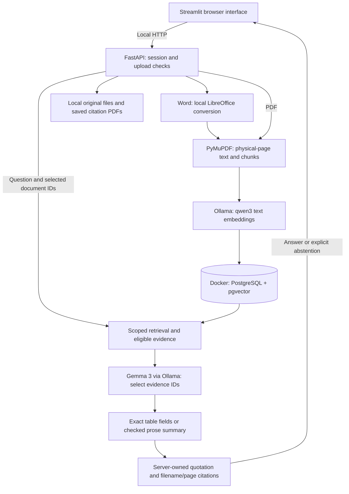

# Brief architecture explanation

The Medical Document Assistant uses retrieval-augmented generation (RAG): it retrieves relevant text from uploaded documents and gives that evidence to a local language model. It does not train or fine-tune the model on uploads.

## Components

| Component | Responsibility |
| --- | --- |
| Streamlit | Document upload, source selection, chat and citation cards; served on localhost:8501 |
| FastAPI | Session boundaries, validation, ingestion, retrieval, answer assembly and source-file endpoints; localhost:8000 |
| PyMuPDF + LibreOffice | Extract physical-page text; convert DOC/DOCX locally into saved PDFs before extraction |
| Ollama | Run `qwen3-embedding:0.6b` for search embeddings and `gemma3:4b` for evidence selection, summarization and support checking; localhost:11434 |
| PostgreSQL + pgvector | Store metadata, extracted pages/chunks and vectors; Docker exposes localhost:5433 |
| Local filesystem | Retain uploaded originals and converted PDFs under `data/sessions/` |

Only the database runs in Docker. Python, Ollama and LibreOffice run on the host Mac. The implemented setup is local-only; it has no hosted model fallback, OCR/vision integration or MLX adapter.

## Document ingestion

The API checks file type, size, page count and session limits. Word files are converted locally using LibreOffice; their originals are retained. PyMuPDF extracts text per physical PDF page. Structure-aware chunking keeps fitting sections/paragraphs together, splits oversized content and never crosses page boundaries.

Ollama embeds each chunk. PostgreSQL stores its text, vector, source document, physical page and exact text offsets. Duplicate bytes within a session are not embedded again. Database transactions and staged file writes keep incomplete uploads from being marked ready; failures preserve previously ready documents.

## Question answering

Each standalone question searches only the selected documents in its session. Source-name and recorded-data checks help distinguish actual patient facts from general advice, examples and blank form fields. Retrieval combines exact vector search with bounded neighboring text and excerpt ranking, using at most six passages and 8,000 evidence characters by default.

Gemma selects server-owned evidence IDs. For prose, a separate request drafts a concise paraphrase from the selected quotations. Deterministic checks cover values, units, scientific identifiers, negation and qualifications; another local-model request checks support/completeness. One bounded repair is allowed at each applicable selection/summary stage. Persistent failure produces an explicit abstention. Supported table lookups use precise field/value statements rather than raw flattened rows.

The server attaches original supporting quotations and filename/page citations. The interface shows these separately from the main answer and can open the cited PDF or extracted page text. Word citations refer to the saved converted PDF's physical pages, which can differ from Word-editor pagination.

## Sessions and limits

Document and source requests enforce session membership and selected-document scope. Chat history is display-only and is never passed to retrieval or the model. Documents can survive a browser reconnect through the session link; they are not permanent storage. Session clearing deletes that session's rows/files, and backend startup cleans up expired sessions using the configured 24-hour threshold.

These checks constrain output but do not prove medical correctness. The support checker uses the same local model family and is not independent clinical review. Complex layouts, scanned files and ambiguous questions remain limitations. There is no production user authentication; session links grant local access.

For setup, see the [README](../README.md). For the request sequence and recorded verification limits, see [question flow](../QUESTION_FLOW.mmd) and [verification summary](verification.md).
